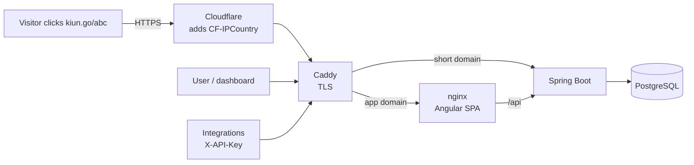

# Architecture



There are two domains:
- **Short domain** (`kiun.go`) goes straight to the backend. `GET /{slug}` returns a 302 redirect.
- **App domain** (`app.kiungo.app`) goes to nginx, which serves the Angular app and forwards `/api/*` to the backend.

## Backend modules

| Package | Responsibility |
|---|---|
| `auth` | Register/login, `JwtService`, `JwtAuthFilter` (Bearer), `ApiKeyAuthFilter` (X-API-Key), `AuthUser` principal |
| `link` | `Link` entity, `LinkService` (validation, slugs, plan quotas), CSV import/export, QR codes |
| `redirect` | `RedirectController`, the hot path |
| `analytics` | `ClickRecorder` (async), `UserAgentParser`, `StatsService` (aggregations) |
| `apikey` | Key generation (shown once, stored as SHA-256), listing, revoking |
| `billing` | Public plans list, checkout/cancel (mock now, Paystack later) |
| `user` | `User`, `Plan` enum, the single source of truth for limits |
| `common` | `ApiException` → JSON errors, `RateLimitFilter` |

### The redirect hot path

1. Look up the link by slug. It's a unique index, so one query.
2. If it's missing, paused, expired or at its limit, redirect to the frontend's `/link-unavailable?reason=…`.
3. Pick the destination: the iOS or Android URL if the device matches, otherwise the original URL. Append the incoming query string.
4. `UPDATE links SET click_count = click_count + 1` (atomic).
5. Hand a `ClickEvent` to `ClickRecorder.record()` (`@Async`). It parses the user agent, flags bots, hashes the IP and stores the click.
6. Return `302` with `Cache-Control: no-store` so browsers don't cache the redirect and every click gets counted.

### Security
- Passwords use BCrypt. JWTs are HS256 with a 24 h lifetime; the secret comes from `JWT_SECRET`.
- API keys look like `kk_live_<32 random chars>`. Only the SHA-256 hash is stored. Keys can't manage other keys, so a leaked key can't mint new ones.
- Destinations must be `http(s)` with a real host, so `javascript:` URLs and loops back to the short domain are rejected. Slugs can't use reserved words.
- Visitor IPs are never stored raw: `sha256(salt + ip)`.
- CSV export escapes formula characters (`= + - @`) to prevent spreadsheet injection.
- CORS only allows `APP_CORS_ORIGINS`.

## Data model

```
users ──< links ──< clicks
  └────< api_keys
```

- **users**: email, password_hash, plan, trial_ends_at, plan_renews_at, theme
- **links**: slug (unique), original_url, title, tags (csv), ios_url, android_url, expires_at, max_clicks, click_count, active
- **clicks**: link_id, user_id (denormalised for fast dashboards), clicked_at, ip_hash, country, city, referrer(_domain), browser, os, device, bot, utm_*
- **api_keys**: user_id, name, prefix, key_hash (unique), last_used_at, expires_at, revoked

Schema changes **always** go in a new Flyway file: `V2__something.sql`, `V3__…`. Never edit `V1`.

## Frontend

- Standalone components, signals and lazy-loaded routes (`app.routes.ts`).
- `core/`: `ApiService` (typed HTTP client), `AuthService` (token + profile signals), `authInterceptor` (adds the JWT, handles 401 and 402), `ThemeService`.
- 402 `PLAN_LIMIT` responses become an "upgrade" toast linking to billing, so plan limits live only in the backend.
- Themes are CSS variables on `<html data-theme>` (`styles.scss`). Add a theme in one CSS block plus one entry in `THEMES`.
- Charts are hand-written SVG (`shared/charts.ts`), with no chart library.

## Scaling path

The current design comfortably handles hundreds of thousands of clicks a day on a $10 VPS. When it outgrows that:

1. **Redis cache for slug lookups** (Spring Cache + Redis), so redirects skip the database.
2. **Queue for clicks**: write click events to Redis Streams or Kafka and consume them in batches.
3. **Analytics rollups**: a nightly job fills `daily_link_stats(link_id, day, country, clicks, …)`, and dashboards read rollups instead of raw clicks. At really large scale, move raw clicks to ClickHouse.
4. **Rate limiting in Redis** (it's currently in-memory per instance). That's needed before running two or more backend replicas.
5. **Split the redirect service**: a tiny stateless service (or a Cloudflare Worker reading from KV) for `/{slug}`, separate from the dashboard API.
